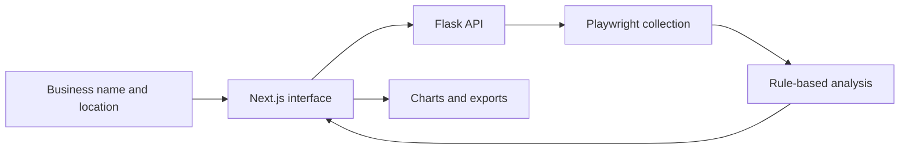

# Verity

A business-review exploration project with a browser-driven collection API, keyword-based sentiment analysis, and a visual reporting interface.

[Live interface](https://verity-orpin-omega.vercel.app/) · [Portfolio case study](https://mohammed-zakee.github.io/Portfolio/case-studies/verity.html)


## Problem and scope

A single star rating does not explain recurring praise, complaints, or changes over time. Verity brings review text, sentiment labels, themes, and a rating timeline into one interface. The screenshot shows the real public landing page; it does not imply that a live collection request or downstream analysis succeeded.

## Current implementation

- **Frontend:** Next.js 14, React, TypeScript, Chart.js.
- **API:** Python, Flask, Flask-CORS.
- **Collection:** Playwright with Chromium.
- **Analysis:** custom positive/negative word sets, immediate-word negation handling, fixed label thresholds, theme matching, and word frequencies.
- **Frontend exports:** JSON, CSV, Excel using SheetJS, and PDF using jsPDF.

The current code uses a rule-based NLP engine. It does **not** call Hugging Face or SerpAPI; earlier descriptions of those integrations no longer describe this version.



## Run locally

Prerequisites: Python 3.11+ and a Node.js version compatible with the frontend package.

Start the API from the repository root:

```sh
python -m venv .venv
# Activate .venv using the command appropriate for your shell.
python -m pip install -r backend/requirements.txt
python -m playwright install chromium
python backend/app.py
```

In a separate terminal:

```sh
cd frontend
npm install
npm run dev
```

Set `NEXT_PUBLIC_API_URL=http://localhost:5000` in `frontend/.env.local` before starting the frontend. Open `http://localhost:3000`. Keep local API addresses out of a production deployment; configure the deployed API origin there.

## Focused behavior checks

```sh
python tests/test_sentiment.py
```

Eight focused checks cover positive, negative, neutral, mixed, negated-positive, negated-negative, case/punctuation, and empty input. They load the analysis function without starting Flask, a browser, or a network request. These checks passed during the portfolio review; they are **not** a benchmark of real-world sentiment accuracy.

## Repository guide

| Path | Purpose |
|---|---|
| `backend/app.py` | Collection, analysis, API health and scrape routes |
| `frontend/app/page.tsx` | Search interface, charts, and exports |
| `backend/requirements.txt` | Python dependencies |
| `Dockerfile` | Container deployment using the backend directory |
| `tests/test_sentiment.py` | Standalone sentiment behavior checks |

A root-level `app.py` and older static/template files also exist. The root Dockerfile uses `backend/`; this guide follows that API and the Next.js frontend.

## Trade-offs and limitations

- Keyword rules are transparent and inexpensive but can misread sarcasm, context, and multilingual reviews.
- Collection depends on the external site's structure, access conditions, and the deployed backend. No collection success-rate or uptime benchmark is documented.
- Relative date grouping is approximate. Collected reviews are a sample and should not be treated as a complete or unbiased business assessment.
- Public interface availability is separate from end-to-end pipeline validation.
- No accuracy, user-adoption, or business-impact figure is claimed here.

## Next engineering steps

Create a labeled review dataset, compare contextual models against the baseline, add collection fixtures and end-to-end deployment checks, and improve coverage of multilingual text and error states.

This README describes repository scope. It does not assign individual module ownership or team size.
